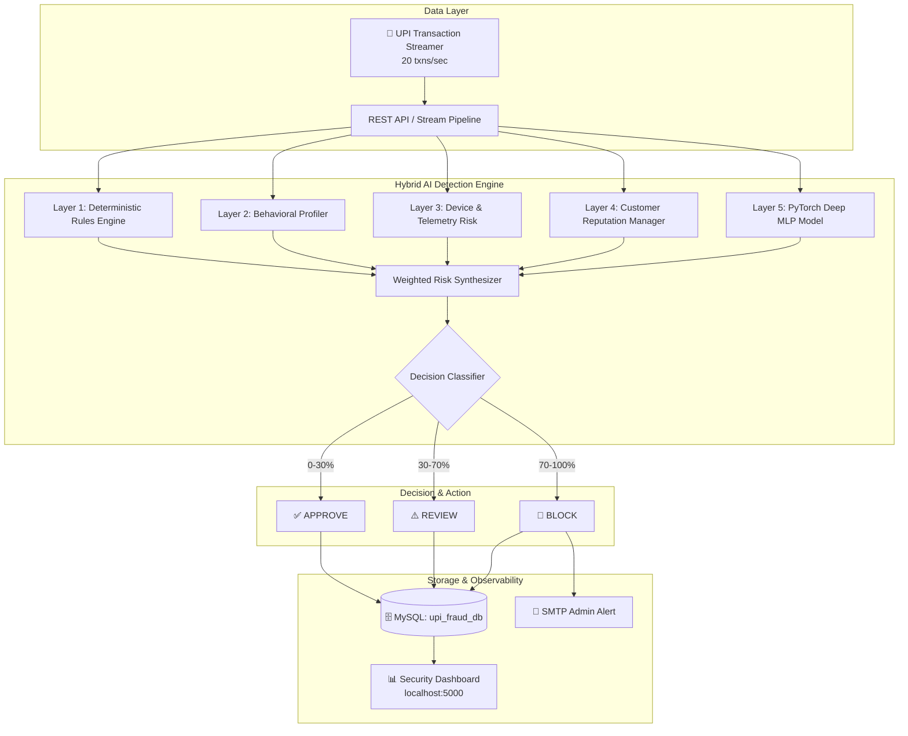

# 🛡️ UPI Fraud Detection & Real-Time Risk Analysis System

[](https://www.python.org/)
[](https://pytorch.org/)
[](https://flask.palletsprojects.com/)
[](https://www.mysql.com/)
[](LICENSE)

An enterprise-grade, AI-driven fraud detection platform engineered specifically for **Unified Payments Interface (UPI)** payment ecosystems. The system analyzes high-throughput transaction streams in real-time, executing hybrid multi-layer risk scoring in **under 200ms** to identify anomalies, prevent financial losses, and enforce instant threat mitigations.

---

## 📌 Executive Overview

Unified Payments Interface (UPI) processes billions of instant, peer-to-peer (P2P) and peer-to-merchant (P2M) transactions monthly. While UPI delivers unmatched financial speed, its instant settlement window leaves traditional batch-oriented anti-fraud systems vulnerable to modern automated attack vectors:

- **Nocturnal Velocity Spikes**: Rapid automated bursts of micro or high-value transactions during low-activity hours (12 AM – 4 AM).
- **Device & SIM Spoofing**: Account takeover attempts using rooted devices, mobile emulators, or recently swapped SIM cards.
- **Behavioral Drift**: Extreme expenditure deviations relative to a customer’s historical standard deviation.
- **Geographical & Foreign IP Inconsistencies**: Transactions originating from high-risk locations or foreign networks masquerading as local payments.

This project delivers an end-to-end operational solution combining a **hybrid multi-layer inference engine** (deterministic business heuristics + deep-learning neural network) with an interactive **Security Operations Center (SOC) dashboard** and real-time streaming pipeline.

---

## 🌟 Key Capabilities

### 1. Hybrid 5-Layer Fraud Detection Pipeline
The detection engine evaluates every incoming transaction across five concurrent analytical layers to determine a holistic risk score from **0 to 100%**:

| Layer | Component | Functionality |
| :--- | :--- | :--- |
| **Layer 1** | **Deterministic Rules Engine** | Evaluates 10+ hard business heuristics including amount thresholds, nocturnal hours, foreign IP flags, and rapid velocity counters. |
| **Layer 2** | **Customer Behavioral Profiling** | Computes running statistical baselines ($Z$-scores) to detect drastic deviations in spending frequency and typical purchase amounts. |
| **Layer 3** | **Device & Telemetry Integrity** | Analyzes hardware signatures to identify rooted phones, developer environments, mobile emulators, and SIM-swap indicators. |
| **Layer 4** | **Adaptive Reputation Manager** | Maintains real-time dynamic trust scores, blacklists, and greylists based on dispute history and past settlement integrity. |
| **Layer 5** | **PyTorch Deep MLP Classifier** | A deep Multi-Layer Perceptron trained to uncover complex, non-linear fraud signatures that evade traditional rule sets. |

### 2. Actionable Tri-State Decision Engine
- **`APPROVE` (0% – 30% Risk)**: Ultra-low risk transaction; processed instantly without friction.
- **`REVIEW` (30% – 70% Risk)**: Moderate risk anomaly; flagged for step-up multi-factor authentication (OTP/biometric verification).
- **`BLOCK` (70% – 100% Risk)**: Critical threat detected; transaction is immediately rejected, logged to incident tables, and escalated.

### 3. Transparent & Explainable AI (XAI)
Every decision includes machine-readable and auditor-friendly reason strings (e.g., `["Amount > ₹50,000", "Nocturnal Hours (02:00 AM)", "Device Risk (Rooted)", "Velocity Breach"]`), eliminating opaque "black-box" rejections.

### 4. Automated Severe-Risk Email Alerts
Background email alerts are instantly dispatched to security administrators via SMTP whenever a transaction receives a `BLOCK` rating or exceeds the configured severe-risk threshold (default: $\ge 70\%$).

### 5. High-Throughput Streaming Engine
A dedicated simulation streamer (`start_streaming.py`) generates and evaluates live UPI transaction flows at **20+ transactions/second**, streaming data directly into indexed MySQL storage while feeding live metrics to the dashboard.

### 6. Interactive SOC Operations Dashboard
A neon dark-mode web console (`http://localhost:5000`) built with Chart.js featuring:
- Real-time transaction counters (Total, Approved, Review, Blocked).
- Risk score distribution charts (Pie & Trendline).
- 24-hour hourly fraud density bar graphs.
- High-risk geographic distribution radar.
- Live streaming transactions audit feed with auto-refresh (5s interval).
- One-click CSV export with detailed reason codes for risk management teams.

---

## 🏗️ Architecture



---

## 🛠️ Technology Stack

| Domain | Technologies |
| :--- | :--- |
| **Machine Learning** | PyTorch (Deep MLP), Scikit-Learn, SHAP, NumPy, Pandas |
| **Backend & Web API** | Python 3.8+, Flask, Flask-CORS, SQLAlchemy, PyMySQL |
| **Database** | MySQL 8.0 (InnoDB with indexing on `customer_id`, `is_fraud`, `risk_score`) |
| **Frontend UI** | Modern Vanilla JavaScript, Chart.js, CSS3 Glassmorphism |
| **Infrastructure** | Multi-threaded Background Workers, SMTP Email Dispatcher |

---

## 📂 Repository Structure

```
├── .env.example                 # Template for environment variables and secrets
├── .gitignore                   # Excludes credentials (.env), logs, and virtual environments
├── ABSTRACT.md                  # Concise technical project abstract
├── ARCHITECTURE.md              # Detailed visual architecture specifications
├── DASHBOARD_DOCUMENTATION.md   # Guide to SOC operations dashboard features
├── DESIGN_DOCUMENT.md           # Comprehensive 10-section engineering design doc
├── POSTMAN_GUIDE.md             # API testing guide and sample payload documentation
├── README.md                    # Project documentation
├── TECHNICAL_DOMAIN_REPORT.md   # Domain analysis of UPI fraud mechanisms
├── email_alerts.py              # Threaded SMTP alert service for severe risk events
├── fraud_detection_api_new.py   # Primary Flask REST API server and dashboard backend
├── fraud_detection_system.py    # Core 5-layer hybrid AI fraud detector module
├── model_accuracy_test.py       # Validation and benchmarking script for the ML model
├── requirements.txt             # Project Python dependencies
├── run_api.bat                  # 1-Click launcher for the REST API server (Windows)
├── run_dashboard.bat            # 1-Click launcher for Streamer + API Dashboard (Windows)
├── setup_upi_database.sql       # MySQL schema definition, tables, and analytics queries
├── start_streaming.py           # High-throughput mock UPI transaction stream generator
├── templates/
│   ├── dashboard.html           # Full-featured SOC operations dashboard
│   └── insights.html            # Analytics and model performance insights page
├── upi_streaming.ipynb          # Jupyter notebook for exploratory data analysis
├── verify_project.py            # Automated end-to-end project verification suite
└── view_transactions.py         # Terminal utility to inspect stored DB transactions
```

---

## 🚀 Getting Started

### 1. Prerequisites
- **Python**: Version 3.8 or higher (Python 3.10 – 3.13 tested)
- **MySQL Server**: Version 8.0 running locally on port 3306
- **Git**: Installed on your system

### 2. Clone the Repository
```bash
git clone https://github.com/Krishnaprasad0705/UPI-Fraud-Detection-Risk-Analysis.git
cd UPI-Fraud-Detection-Risk-Analysis
```

### 3. Configure Environment Variables
Copy `.env.example` to `.env`:
```bash
copy .env.example .env
```
Open `.env` and fill in your database credentials and optional SMTP mailer configuration:
```env
# Database Configuration
UPI_DB_HOST=localhost
UPI_DB_PORT=3306
UPI_DB_USER=root
UPI_DB_PASSWORD=YourMySQLPassword
UPI_DB_NAME=upi_fraud_db

# Security & Admin Settings
UPI_AUTH_SECRET=upi-fraud-detection-secure-key-2026
UPI_ADMIN_USER=admin
UPI_ADMIN_PASSWORD=admin123

# Email Alerts (Optional - for severe fraud alerts)
UPI_ALERT_RECIPIENT=admin@example.com
UPI_EMAIL_SEVERE_RISK_THRESHOLD=70
UPI_SMTP_HOST=smtp.gmail.com
UPI_SMTP_PORT=587
UPI_SMTP_USERNAME=your-account@gmail.com
UPI_SMTP_PASSWORD=your-app-password
```

### 4. Install Dependencies
```bash
pip install -r requirements.txt
```

### 5. Launch the System

#### Option A: 1-Click Launch (Recommended for Windows)
Double-click `run_dashboard.bat` or run:
```cmd
run_dashboard.bat
```
*This installs requirements, initializes the database tables, launches the transaction stream generator in a background terminal, and opens the API dashboard.*

#### Option B: Manual Startup
1. **Initialize the Database**:
   ```bash
   mysql -u root -p < setup_upi_database.sql
   ```
2. **Start the Real-Time Transaction Streamer**:
   ```bash
   python start_streaming.py
   ```
3. **Start the API & Dashboard Server**:
   ```bash
   python fraud_detection_api_new.py
   ```

4. **Access the Web Dashboard**:
   Open **[http://localhost:5000](http://localhost:5000)** in your browser.

---

## 📡 REST API Reference

The server exposes RESTful endpoints for transaction scoring and security operations:

| Method | Endpoint | Description |
| :--- | :--- | :--- |
| `GET` | `/` | Web Operations Dashboard |
| `GET` | `/health` | System health check and API version status |
| `GET` | `/api/stats` | Real-time transaction totals (Approved, Review, Blocked) |
| `POST` | `/api/analyze` | Evaluate a single transaction through the hybrid AI pipeline |
| `POST` | `/api/batch_analyze` | Score a batch of transactions concurrently |
| `GET` | `/api/alerts` | Fetch recent high-risk transactions (`risk_score > 70%`) |
| `GET` | `/api/customer/<id>/profile` | Retrieve historical behavioral profile for a customer |
| `GET` | `/api/customer/<id>/reputation` | Retrieve trust score and violation history |
| `POST` | `/api/blacklist/<type>/<id>` | Blacklist a fraudulent device, customer, or IP |
| `POST` | `/api/simulate_transaction` | Generate and score an on-demand simulated payment |
| `GET` | `/api/export/blocked` | Download CSV audit report of blocked transactions |
| `GET` | `/api/export/review` | Download CSV audit report of flagged review transactions |

### Sample Analysis Request (`POST /api/analyze`)

```json
{
  "customer_id": "C4918",
  "transaction_amount": 75000.0,
  "transaction_hour": 2,
  "is_foreign_transaction": 1,
  "failed_login_attempts": 3,
  "device_type": "Android",
  "location": "Mumbai",
  "account_balance": 120000.0,
  "device_info": {
    "is_rooted": true,
    "is_emulator": false
  }
}
```

### Sample Response

```json
{
  "transaction_id": "TXN_9823102",
  "risk_score": 88.5,
  "classification": "BLOCK",
  "decision": "REJECT",
  "triggered_rules": [
    "High Amount (> ₹50,000)",
    "Nocturnal Hours (02:00 AM)",
    "Foreign Transaction",
    "Rooted Phone Detected",
    "Multiple Failed Login Attempts"
  ],
  "breakdown": {
    "rule_score": 38.0,
    "ml_score": 28.5,
    "device_score": 15.0,
    "behavioral_score": 7.0
  },
  "timestamp": "2026-10-17T10:45:00"
}
```

---

## 📊 Performance & Benchmarks

- **Inference Latency**: Sub-`200ms` per transaction across the complete 5-layer pipeline.
- **Continuous Ingestion Rate**: Tested up to **20–30 transactions/second** in local development environments.
- **Model Validation**: Deep Learning PyTorch MLP delivers **> 99% accuracy** on adversarial synthetic evaluation splits.

---

## 📄 License

This project is licensed under the MIT License - see the [LICENSE](LICENSE) file for details.
